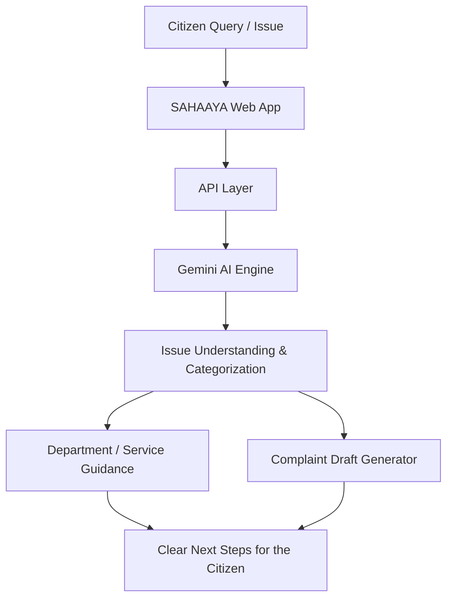

<div align="center">

# 🤝 SAHAAYA (सहाय)

### Help For Every Citizen — AI-Powered Civic Assistance

**Making government services, civic complaints, and public information simple, accessible, and conversational.**

[](https://sahaaya-ai-for-civic-assistance.vercel.app/)
[](https://vercel.com)
[](https://react.dev)
[](https://www.typescriptlang.org)
[](https://ai.google.dev)
[](LICENSE)

<br/>

### 🔗 [**⚡ LAUNCH THE LIVE PLATFORM ⚡**](https://sahaaya-ai-for-civic-assistance.vercel.app/)

**`https://sahaaya-ai-for-civic-assistance.vercel.app/`**

<br/>

[Overview](#-overview) · [Key Features](#-core-capabilities) · [Architecture](#️-system-architecture) · [Tech Stack](#-tech-stack) · [Setup](#-getting-started) · [Deployment](#️-deployment) · [Roadmap](#️-roadmap)

</div>

---

## 📌 Overview

Most civic problems are not caused by missing services — they are caused by **missing guidance**. Which office handles this? Which form do I need? Where do I file a complaint, and what happens after I do? Citizens lose hours (and hope) navigating portals and counters that were never designed around them.

**SAHAAYA** (सहाय — "help") is an AI-powered civic assistant that turns that maze into a conversation. Describe your problem in plain language, and SAHAAYA helps you understand it, find the right department or scheme, and take the next step — without needing to know the system first.

---

## ✨ Core Capabilities

<!-- NOTE: Review this list against the actual repo and remove or rename anything that does not match what is built. -->

### 💬 Conversational Civic Assistant
Ask questions in natural language about civic issues, public services, and government procedures, and get clear, step-by-step guidance powered by **Google Gemini**.

### 📝 Guided Complaint & Grievance Drafting
Walks a citizen through describing an issue — category, location, details, and impact — and produces a clear, well-structured complaint ready to submit to the right authority.

### 🏛️ Service & Department Finder
Helps users identify which department, office, or scheme is responsible for their problem, so a request reaches the right desk the first time.

### 🌐 Multilingual Experience
Civic help that works in the language people actually speak, so access to services does not depend on English fluency.

### 📱 Responsive, Mobile-First Interface
A clean, fast interface designed for the phone in a citizen's hand, not just the desktop in an office.

### 🔒 Responsible by Design
Clear boundaries on what the assistant will and will not advise on, with a focus on guidance and information rather than legal or official determinations.

---

## 🏗️ System Architecture



**Flow:** a citizen describes a problem → the AI understands and categorizes it → SAHAAYA points to the right service or department and, where needed, drafts a structured complaint → the citizen leaves with a clear next step.

---

## 🧰 Tech Stack

<!-- NOTE: Adjust this table to match package.json. -->

| Layer | Technology |
|---|---|
| **Frontend** | React, TypeScript, Tailwind CSS |
| **AI** | Google Gemini |
| **Backend** | Node.js / serverless API routes |
| **Deployment** | Vercel |

---

## 🚀 Getting Started

### Prerequisites
- **Node.js 18+**
- A **Google Gemini API key** — [get one here](https://aistudio.google.com/apikey)

### Installation

```bash
# 1. Clone the repository
git clone https://github.com/sathi2305/SAHAAYA-AI-FOR-Civic-Assistance.git
cd SAHAAYA-AI-FOR-Civic-Assistance

# 2. Install dependencies
npm install

# 3. Configure environment
echo "GEMINI_API_KEY=your_key_here" > .env

# 4. Start the dev server
npm run dev
```

### Environment Variables

```env
GEMINI_API_KEY=
```

> 🔐 `.env` is gitignored — never commit API keys. Rotate immediately if one is ever exposed.

---

## ☁️ Deployment

Deployed on **Vercel**.

| Setting | Value |
|---|---|
| **Framework Preset** | Vite |
| **Build Command** | `npm run build` |
| **Environment Variables** | `GEMINI_API_KEY` (set as a secret) |

**Live URL:** https://sahaaya-ai-for-civic-assistance.vercel.app/

---

## 🗺️ Roadmap

- [ ] Voice input for citizens who prefer speaking over typing
- [ ] Expanded regional-language coverage
- [ ] Direct integration with official grievance portals for live submission
- [ ] Complaint tracking across its full lifecycle
- [ ] Location-aware department and office lookup
- [ ] Persistent accounts for saved history

---

## 🤝 Contributing

```bash
git checkout -b feature/your-feature-name
git commit -m "Add: clear description of your change"
git push origin feature/your-feature-name
# Open a Pull Request
```

---

## 📄 License

Distributed under the MIT License. See [`LICENSE`](LICENSE) for details.

---

## 👤 Author

**Sathiyamoorthi**

[](https://github.com/sathi2305)

---

<div align="center">

### ⭐ If this project helps you, consider starring the repository.

**[🤝 Try the Live Platform](https://sahaaya-ai-for-civic-assistance.vercel.app/)**

*सहाय — good governance starts with accessible help.*

</div>
